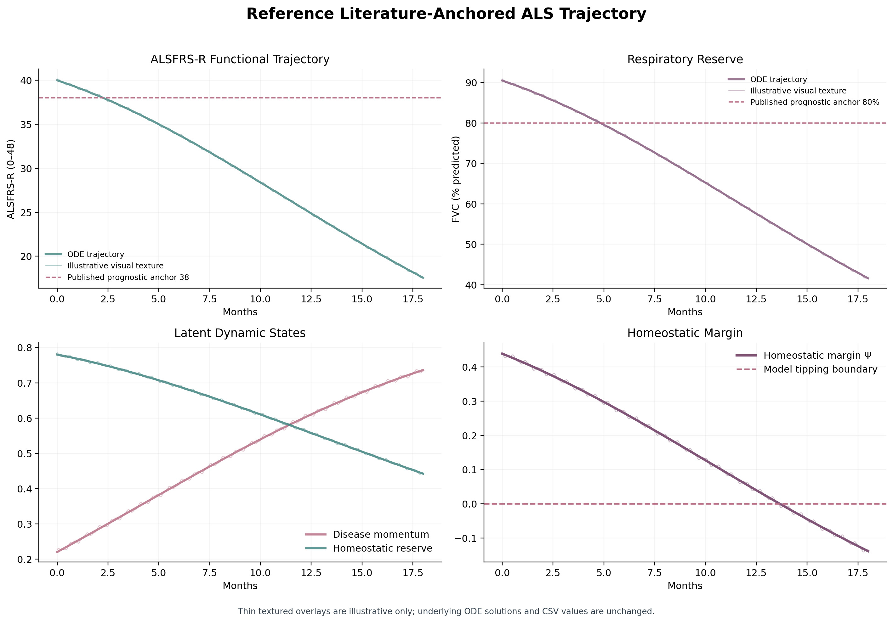
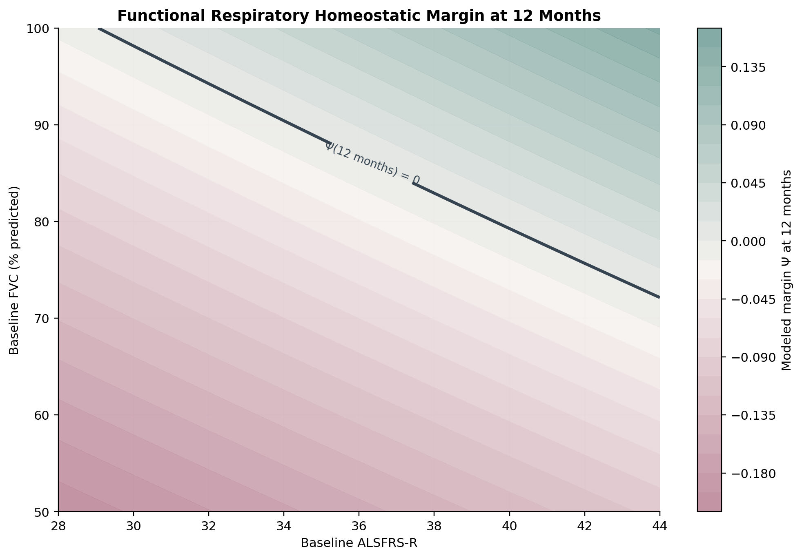
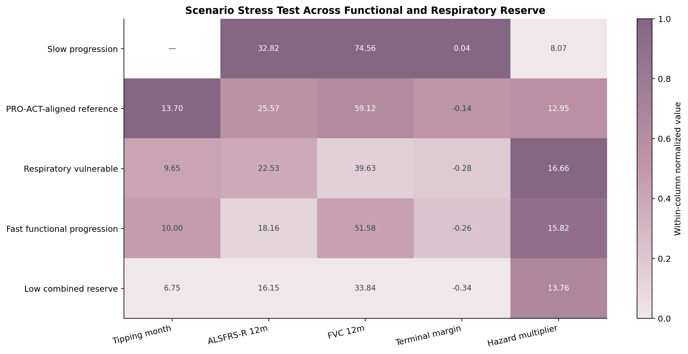
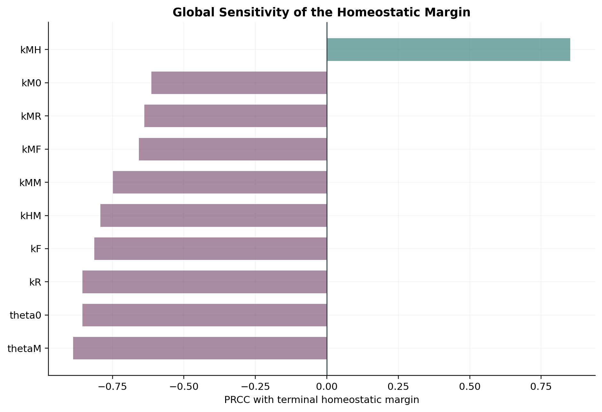
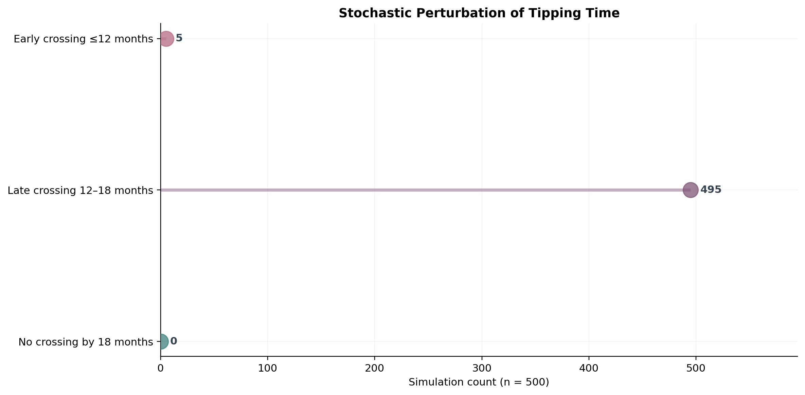
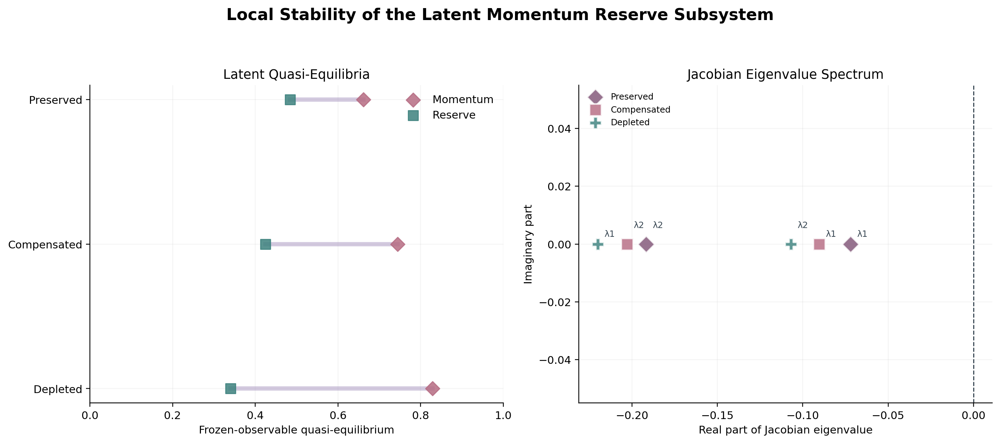
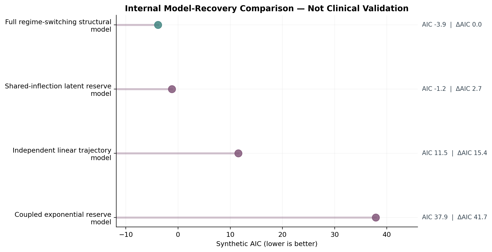
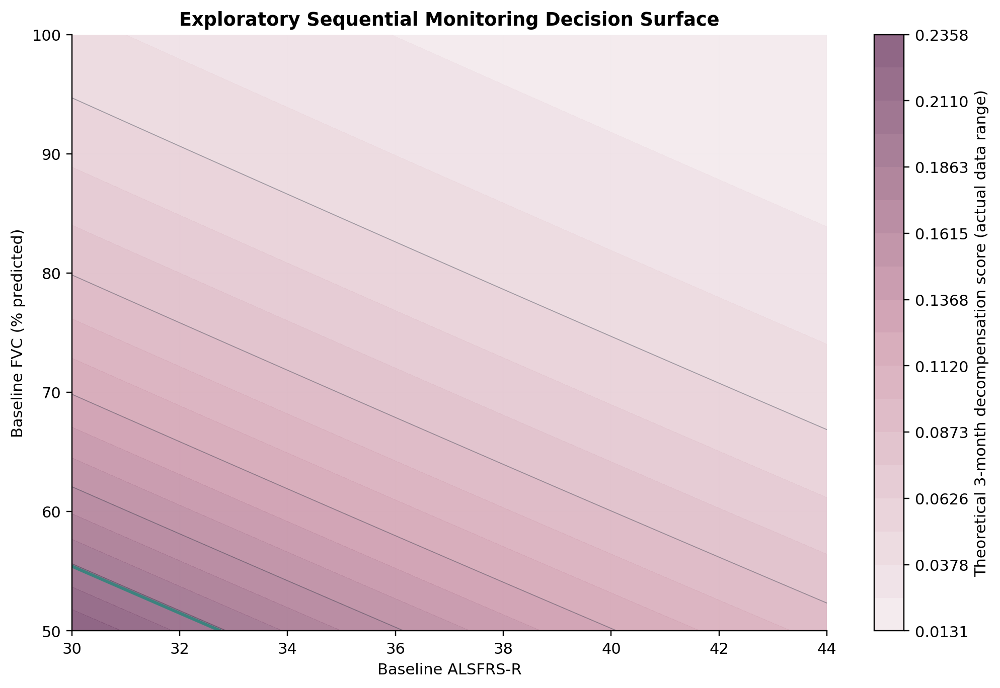
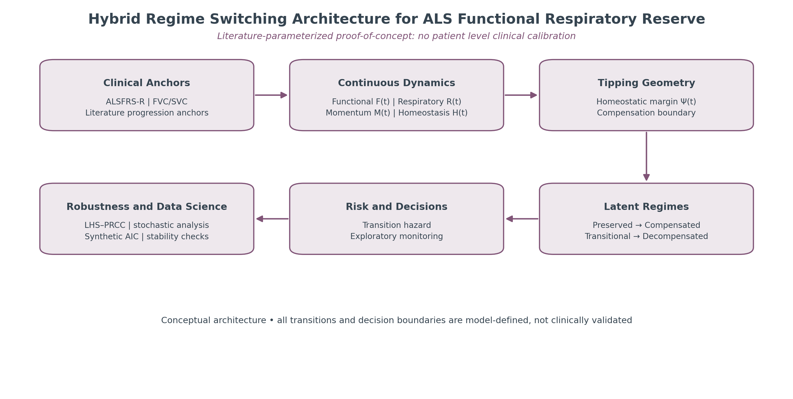

# ALS Regime Switching Attrition Model

## Regime Switching Model of ALSFRS-R Attrition and Respiratory Reserve Delineates Homeostatic Tipping Boundaries in Amyotrophic Lateral Sclerosis

**Full theoretical manuscript, reproducible numerical experiments, global sensitivity analysis, stochastic perturbations, and a clinical-validation roadmap**

   

---

## Overview

Amyotrophic lateral sclerosis (ALS) is associated with heterogeneous functional and respiratory deterioration. The ALS Functional Rating Scale–Revised (ALSFRS-R) and vital capacity measurements provide complementary clinical information, but a mathematically explicit compensation boundary for their coupled trajectories is not an established clinical quantity.

This repository contains a **literature-parameterized, four-state nonlinear mathematical model** examining how simulated functional attrition and respiratory decline interact with two latent mathematical constructs: disease momentum and homeostatic reserve. The central quantity is a weighted homeostatic margin whose first passage through zero defines a **model-specific compensation boundary**.

The study combines:

- four coupled nonlinear ordinary differential equations (ODEs);
- deterministic margin-based classification into four reserve regimes;
- first-passage timing and 12-month compensation-boundary continuation;
- five prespecified functional–respiratory scenarios;
- frozen-observable latent quasi-equilibria and Jacobian eigenvalue analysis;
- phase-plane analysis;
- 500 Latin hypercube parameter draws and partial rank correlation coefficients (PRCCs);
- local finite-difference sensitivity;
- 500 Euler–Maruyama stochastic trajectories;
- RK45/DOP853 numerical robustness checks;
- an internal **synthetic** model-recovery benchmark; and
- an exploratory, nonclinical three-month monitoring score.

**The purpose is mathematical hypothesis generation and reproducibility, not individual ALS prognosis or clinical decision support.**

---

## Research Status and Integrity Statement

> **Working theoretical proof-of-concept — not calibrated or validated on patient-level ALS records.**

The published ALS literature informs variable selection and approximate cohort-level decline rates. No individual PRO-ACT records, ALS registry trajectories, patient outcomes, or treatment responses were fitted or externally validated in this project. Reference initial conditions, latent states, ODE coefficients, regime thresholds, diffusion amplitudes, and monitoring costs are provisional model choices.

In particular:

- `F` and `R` are normalized clinical observables, while `M` and `H` are **latent mathematical constructs**, not measured biomarkers.
- The four regimes are **deterministic labels assigned from the margin**, not an estimated continuous-time Markov chain or hidden Markov model.
- The `Ψ = 0` crossing is a **model first-passage event**, not evidence of a biological bifurcation or validated clinical tipping point.
- The hazard multiplier is an **imposed mathematical index**, not a fitted event hazard ratio.
- The stochastic distributions and LHS percentiles describe **assumed computational uncertainty**, not patient-population distributions or clinical confidence intervals.
- The synthetic AIC comparison is an internal benchmark, **not external clinical validation**.
- The monitoring surface is a deterministic exploratory rule, **not a recommendation for follow-up intervals, noninvasive ventilation, or treatment**.

---

## 1. Clinical and Mathematical Motivation

ALSFRS-R measures functional limitations on a 0–48 scale. Forced vital capacity (FVC) and slow vital capacity (SVC) are related but distinct measures of respiratory function. Published PRO-ACT cohort analyses reported approximate mean declines of **1.02 ALSFRS-R points/month** and **2.24 vital-capacity percentage points/month** (Atassi et al., 2014). These cohort averages are used for orientation only; they are not individual patient observations or direct estimates of ODE coefficients.

The mathematical question is whether coupled functional and respiratory trajectories, together with hypothetical latent momentum and compensation states, can define an explicit, reproducible **finite-horizon compensation boundary**. This is distinct from established ALS staging and validated survival-prediction approaches.

---

## 2. Model State Variables

All four states are dimensionless and initialized within `[0, 1]`; time is measured in **months**.

| Symbol | State | Definition / interpretation |
|---|---|---|
| `F(t)` | Functional reserve | Normalized ALSFRS-R, `ALSFRS-R(t) / 48` |
| `R(t)` | Respiratory reserve | Normalized FVC, `FVC(% predicted) / 100` in the primary simulation |
| `M(t)` | Disease momentum | Latent mathematical construct representing accumulated deterioration pressure |
| `H(t)` | Homeostatic reserve | Latent mathematical construct representing compensatory capacity |

`M` and `H` have not been independently measured or identified from longitudinal patient data.

---

## 3. Governing Nonlinear Dynamical System

The **implemented Python model** is:

```text
dF/dt = -kF*M*F - kFR*(1-R)*F

dR/dt = -kR*M*R - kRF*(1-F)*R

dM/dt = kM0*(1-M) + kMF*(1-F)*(1-M)
      + kMR*(1-R)*(1-M) + kMM*M*(1-M) - kMH*H*M

dH/dt = kHF*F*(1-H) + kHR*R*(1-H)
      - kHM*M*H - kHd*H
```

For nonnegative structural coefficients, the vector field is inward-pointing or tangent at the boundaries of `[0,1]^4`, supporting forward invariance for normalized initial conditions. The deterministic model imposes nonincreasing `F` and `R`; it does not represent recovery or intervention effects.

**Manuscript–code consistency note:** The supplied manuscript's displayed `dM/dt` equation writes the `kMM` term differently from the executable code. The equation above documents the executable implementation (`kMM*M*(1-M)`). The manuscript and code must be reconciled before treating the repository as a fully consistent archival release.

---

## 4. Homeostatic Margin and Regime Classification

The operational margin is

```text
Psi(t) = wF*F(t) + wR*R(t) + wH*H(t) - theta0 - thetaM*M(t)
```

Reference weights and offsets are `wF = 0.34`, `wR = 0.34`, `wH = 0.32`, `theta0 = 0.34`, and `thetaM = 0.28`.

| Model margin | Computational regime |
|---|---|
| `Psi > 0.25` | Preserved reserve |
| `0.10 < Psi <= 0.25` | Compensated |
| `0 < Psi <= 0.10` | Transitional |
| `Psi <= 0` | Decompensated |

The first-passage time is defined by

```text
tau* = inf { t >= 0 : Psi(t) <= 0 }
```

Within the numerical experiments, crossing is recorded at the first sampled time with `Psi <= 0`; a trajectory without crossing during the 18-month horizon is reported as not crossed. These are **provisional computational classifications**, not validated ALS clinical stages.

---

## 5. Illustrative Transition-Hazard Index

An additional model index is

```text
h(t) = h0 * exp[bM*M(t) + bF*(1-F(t))
                + bR*(1-R(t)) - bH*H(t)]
```

The reference coefficients are `h0 = 0.015`, `bM = 1.8`, `bF = 1.2`, `bR = 1.5`, and `bH = 1.0`. Reported multipliers use `h(t)/h(0)`.

**No event-time likelihood was fitted.** This is not an empirical hazard ratio, calibrated transition probability, or patient event rate.

---

## 6. Parameter Strategy and Provenance

The numerical parameters are provisional assumptions, while clinical literature anchors supply context for observable quantities and approximate early decline rates. The input CSV files in `data/` document the numerical values; **the main Python model currently contains its parameters directly in the script and does not automatically read those CSVs**.

### Reference structural coefficients

| Parameter | Value | Parameter | Value |
|---|---:|---|---:|
| `kF` | 0.080 | `kFR` | 0.018 |
| `kR` | 0.075 | `kRF` | 0.015 |
| `kM0` | 0.020 | `kMF` | 0.080 |
| `kMR` | 0.100 | `kMM` | 0.090 |
| `kMH` | 0.100 | `kHF` | 0.035 |
| `kHR` | 0.045 | `kHM` | 0.100 |
| `kHd` | 0.012 | `theta0` | 0.340 |
| `thetaM` | 0.280 | `wF` | 0.340 |
| `wR` | 0.340 | `wH` | 0.320 |
| `h0` | 0.015 | `bM` | 1.800 |
| `bF` | 1.200 | `bR` | 1.500 |
| `bH` | 1.000 | | |

Rate coefficients have month-based units where appropriate; margin weights and index multipliers are model-defined. None of these reference coefficients is a patient-fitted biological estimate.

### Clinical and numerical anchors

| Quantity | Value | Status |
|---|---:|---|
| ALSFRS-R scale | 0–48 | Published clinical scale |
| PRO-ACT mean ALSFRS-R decline | 1.02 points/month | Published cohort-level orientation |
| PRO-ACT mean vital-capacity decline | 2.24 percentage points/month | Published cohort-level orientation |
| SVC decline context | ~2.7 percentage points/month | Separate respiratory benchmark; not FVC calibration |
| Reference ALSFRS-R | 40 | Illustrative initial value |
| Reference FVC | 90.5% predicted | Illustrative initial value |
| ALSFRS-R 38 / FVC 80% | Reference lines | Visualization / literature context, not validated model thresholds |

See `data/model_parameters.csv`, `data/parameter_ranges_LHS.csv`, `data/literature_anchors.csv`, `data/scenario_inputs.csv`, and `data/simulation.csv` (the simulation-settings filename in the supplied archive).

---

## 7. Numerical Implementation

| Setting | Implementation |
|---|---|
| Language | Python |
| Main ODE integrator | `scipy.integrate.solve_ivp` |
| Reference solver | RK45 |
| Alternative solver | DOP853 |
| Reference horizon | 18 months |
| Reference output interval | 0.05 months |
| Relative tolerance | `1e-8` |
| Absolute tolerance | `1e-10` |
| Initial state `[F,R,M,H]` | `[40/48, 0.905, 0.22, 0.78]` |
| Baseline surface | 17 ALSFRS-R × 26 FVC values = 442 combinations |
| LHS parameter sets | 500 |
| Stochastic paths | 500 |
| Stochastic step | 0.05 months |
| Random seed | `20260825` |

Numerical robustness additionally compares RK45 and DOP853 across maximum steps of `1.0`, `0.5`, `0.25`, and `0.10` months with tighter tolerances.

---

## 8. Reference Trajectory and First Passage

The reference simulation starts at ALSFRS-R **40**, FVC **90.5% predicted**, `M(0) = 0.22`, and `H(0) = 0.78`.

| Output | Simulated value |
|---|---:|
| Mean ALSFRS-R change, months 0–6 | −1.037 points/month |
| Mean FVC change, months 0–6 | −2.268 percentage points/month |
| ALSFRS-R at month 6 | 33.78 |
| FVC at month 6 | 76.89% |
| ALSFRS-R at month 12 | 25.57 |
| FVC at month 12 | 59.12% |
| First sampled `Psi <= 0` | **13.70 months** |
| ALSFRS-R at month 18 | 17.56 |
| FVC at month 18 | 41.60% |
| `Psi` at month 18 | −0.138742 |
| Model hazard-index multiplier at month 18 | 12.95× |

The reference slopes were intentionally oriented toward published cohort averages. Their proximity to literature benchmarks is **not independent validation**.



---

## 9. Twelve-Month Compensation Surface

A baseline grid evaluates ALSFRS-R from **28 to 44** and FVC from **50% to 100% predicted**. With common latent initial states and fixed provisional coefficients, the 442 month-12 margin values were classified as:

| Month-12 model margin | Grid cells | Share of prespecified grid |
|---|---:|---:|
| `Psi < 0` | 323 | 73.1% |
| `0 <= Psi < 0.10` | 104 | 23.5% |
| `Psi >= 0.10` | 15 | 3.4% |

The numerical zero contour `Psi(12 months) = 0` is a model-derived surface. It is not a clinical cut-off and the grid percentages are not population prevalence.

Selected minimum baseline FVC values for a nonnegative month-12 margin:

| Initial ALSFRS-R | Minimum modeled baseline FVC |
|---|---:|
| 30 | 99% |
| 38 | 83% |
| 40 | 80% |
| 44 | 73% |

The staircase appearance of the continuation curve reflects the discrete sampling grid.



---

## 10. Prespecified Scenario Stress Tests

Five illustrative scenarios vary baseline states and selected model coefficients. They do not represent fitted patient subgroups.

| Scenario | First crossing | ALSFRS-R at 12m | FVC at 12m | Margin at 18m |
|---|---:|---:|---:|---:|
| Slow progression | Not by 18m | 32.82 | 74.56% | +0.041 |
| PRO-ACT-aligned reference | 13.70m | 25.57 | 59.12% | −0.139 |
| Respiratory vulnerable | 9.65m | 22.53 | 39.63% | −0.276 |
| Fast functional progression | 10.00m | 18.16 | 51.58% | −0.262 |
| Low combined reserve | 6.75m | 16.15 | 33.84% | −0.344 |

Scenario labels and crossing times are model-specific. They should not be interpreted as observed clinical risk groups or predicted patient outcomes.



---

## 11. Global Sensitivity and Parameter Uncertainty

A **500-draw Latin hypercube experiment** samples 15 provisional structural coefficients from predefined uniform intervals. PRCCs are calculated for terminal homeostatic margin after rank residualization against the other sampled inputs.

| Parameter | PRCC with month-18 margin |
|---|---:|
| `thetaM` | −0.888 |
| `theta0` | −0.856 |
| `kR` | −0.855 |
| `kMH` | +0.852 |
| `kF` | −0.813 |
| `kHM` | −0.792 |

The month-18 margin had a median of approximately **−0.1507** and 2.5th–97.5th simulation percentiles of **−0.3094 to −0.0016**. Under the selected parameter ranges, **97.8%** of parameter draws crossed `Psi = 0` by month 18.

These are **conditional sensitivity outputs**. The large effects of `theta0` and `thetaM` partly reflect the fact that they define the margin itself. Local +1% finite-difference sensitivity is also archived; its normalization should not be mistaken for conventional logarithmic elasticity when the output is negative.



---

## 12. Stochastic Perturbation Experiment

The model uses Euler–Maruyama steps with Gaussian increments and projection to `[0,1]`:

```text
X[n+1] = clip_0_1( X[n] + f(X[n]; theta)*dt
                    + diag(sigma)*sqrt(dt)*epsilon[n] )

epsilon[n] ~ N(0, I)
```

The illustrative diffusion amplitudes are `sigma = (0.005, 0.006, 0.015, 0.012)` for `(F, R, M, H)`.

Across **500** stochastic paths:

| First-passage class | Paths |
|---|---:|
| Crossing by month 12 | 5 |
| Crossing after month 12, by month 18 | 495 |
| No crossing by month 18 | 0 |

Median simulated crossing time was **13.65 months** (2.5th–97.5th simulation percentiles: **12.27–15.15 months**). The noise amplitudes were not estimated from patient data; these are not clinical confidence intervals.



---

## 13. Latent Quasi-Equilibria and Local Stability

To evaluate the latent `M–H` subsystem, observable `F` and `R` are frozen at three illustrative anchors. A two-dimensional root and numerical Jacobian are computed for each condition.

| Fixed ALSFRS-R / FVC | Latent `M*` | Latent `H*` | Dominant real eigenvalue |
|---|---:|---:|---:|
| 42 / 95% | 0.661 | 0.484 | −0.072 |
| 38 / 80% | 0.745 | 0.424 | −0.090 |
| 30 / 60% | 0.829 | 0.340 | −0.107 |

Negative real eigenvalues support **local asymptotic stability of the frozen-observable latent subsystem at these anchors**. They do **not** establish equilibrium stability of the evolving full four-state ALS model or demonstrate a clinical bifurcation.



---

## 14. Numerical Robustness

The reference trajectory was checked using **RK45** and **DOP853** with four maximum-step settings. The reported terminal margin agreed to approximately six decimal places (`−0.138742`), and the sampled crossing time remained **13.70 months**.

This establishes numerical consistency for the tested implementation, not biological or clinical validity.

---

## 15. Synthetic Model-Recovery Benchmark

Monthly **pseudo-observations** over months 0–12 were generated from the reference structural model with stipulated Gaussian noise (`0.45` ALSFRS-R points and `1.8` FVC percentage points). Four candidate specifications were compared using a standardized-residual AIC-like score.

| Candidate specification | Archived AIC* | Archived delta AIC* |
|---|---:|---:|
| Generating structural model | −3.86 | 0.00 |
| Shared-inflection latent reserve model | −1.19 | 2.67 |
| Independent linear trajectory model | 11.53 | 15.39 |
| Coupled exponential reserve model | 37.89 | 41.74 |

**Important implementation limitation:** `theta0` is counted as a fitted parameter for the structural benchmark even though it does not affect the simulated ALSFRS-R/FVC pseudo-observations. The archived AIC* values and rankings are **provisional** until the effective parameter count and comparison are corrected. This is not evidence of superior performance on patient data.



---

## 16. Exploratory Three-Month Monitoring Surface

The model evaluates a three-month margin on a grid of baseline ALSFRS-R and FVC combinations, then applies the deterministic transformation

```text
s = 1 / (1 + exp(10*Psi(3 months)))
```

An **illustrative** escalated-review label is assigned when `s > 0.20`, corresponding to an assumed monitoring-cost threshold. This is **not** a fitted event probability, a solved Bellman optimal-stopping policy, or a clinical recommendation.



---

## 17. Figures

Twelve PNG figures are archived in `figures/`:

| Figure | File | Content |
|---|---|---|
| 1 | `Figure_1_Model_Architecture.png` | Conceptual architecture |
| 2 | `Figure_2_Reference_Trajectory.png` | Reference trajectories and margin |
| 3 | `Figure_3_ALSFRS_FVC_Tipping_Surface.png` | Month-12 compensation surface |
| 4 | `Figure_4_Tipping_Boundary_Continuation.png` | Discrete boundary continuation |
| 5 | `Figure_5_Scenario_Stress_Test.png` | Scenario stress-test heatmap |
| 6 | `Figure_6_Global_Sensitivity_PRCC.png` | Global sensitivity |
| 7 | `Figure_7_Stochastic_Tipping_Classes.png` | Stochastic first-passage classes |
| 8 | `Figure_8_Latent_Stability.png` | Frozen-observable latent stability |
| 9 | `Figure_9_Phase_Plane.png` | Latent phase portrait |
| 10 | `Figure_10_Synthetic_AIC.png` | Synthetic internal model recovery |
| 11 | `Figure_11_Sequential_Monitoring_Surface.png` | Exploratory monitoring score |
| 12 | `Figure_12_Validation_Roadmap.png` | Future clinical-validation roadmap |

**Figure 2 disclosure:** Thin textured overlays in the revised visualization are illustrative display elements, not additional observations or altered ODE solutions. Numerical results are retained in the CSV outputs.




---

## 18. Repository Structure

```text
als-regime-switching-attrition/
├── README.md
├── requirements.txt
├── LICENSE                         # if added to the repository
├── CITATION.cff                    # if added to the repository
├── code/
│   ├── als_tipping_model.py
│   ├── make_figures.py
│   └── als_tipping_model_original.py
├── data/
│   ├── model_parameters.csv
│   ├── parameter_ranges_LHS.csv
│   ├── literature_anchors.csv     # optional if not uploaded
│   ├── scenario_inputs.csv
│   └── simulation.csv
├── results/
│   ├── Reference_Trajectory.csv
│   ├── Scenario_Results.csv
│   ├── ALSFRS_FVC_Tipping_Surface.csv
│   ├── Tipping_Boundary_Continuation.csv
│   ├── LHS_Parameter_Samples.csv
│   ├── LHS_Model_Outputs.csv
│   ├── Global_Sensitivity_PRCC.csv
│   ├── Local_Elasticity.csv
│   ├── Stochastic_Perturbation_Results.csv
│   ├── Latent_Quasi_Equilibria.csv
│   ├── Latent_Quasi_Equilibrium_Eigenvalues.csv
│   ├── Numerical_Robustness.csv
│   ├── Synthetic_Benchmark_Outputs.csv
│   ├── Synthetic_Model_Comparison_AIC.csv
│   ├── Exploratory_Sequential_Monitoring_Output.csv
│   └── Analysis_Summary.json
├── figures/
│   └── Figure_1_...png through Figure_12_...png
└── manuscript/
    └── ALS Regime Switching Full Manuscript Fix.pdf   # once uploaded
```

The names above reflect the **supplied organized ZIP**, not an independently verified live GitHub file listing. Some archive filenames differ from the filenames produced by the main script; see the reproduction note below.

---

## 19. Installation

Clone the repository and install dependencies:

```bash
git clone https://github.com/TitinPrihantini4/als-regime-switching-attrition.git
cd als-regime-switching-attrition
python -m pip install -r requirements.txt
```

The dependency list includes `numpy`, `pandas`, `matplotlib`, `scipy`, and `scikit-learn`.

---

## 20. Reproducing Figures from Archived Results

The dedicated plotting script reads archived CSVs from `results/` and writes twelve PNGs into `figures/`:

```bash
python code/make_figures.py
```

**Archive filename compatibility:** In the supplied ZIP, two files are named `Synthetic_Benchmark_Outputs.csv` and `Exploratory_Sequential_Monitoring_Output.csv`, whereas the plotting script expects `Synthetic_Benchmark_Observations.csv` and `Exploratory_Sequential_Monitoring_Policy.csv`. Before running the plotting script on the archived package, rename those two files to the expected names **after confirming that their column schemas match**. Merely renaming files cannot fix incompatible content.

The figure-only script does not refit the ODE model, rerun LHS, regenerate stochastic paths, or repeat synthetic AIC fitting.

---

## 21. Reproducing the Full Computational Analysis

The main model script in the supplied archive is:

```bash
python code/als_tipping_model.py
```

**Path compatibility:** As supplied, this script writes its generated CSV/JSON files to the **repository root**, while its PNGs go into `figures/`. It does **not** automatically write CSVs into `results/`. To use the standalone plotting workflow after a full run, move the generated CSV/JSON files into `results/`, preserving the filenames expected by `make_figures.py`, or update the main script's output path.

The `data/` input tables are currently documentation exports of hard-coded settings; editing them alone will not change a simulation. To change the computational experiment, update the parameters in the executable script and regenerate outputs. The retained `als_tipping_model_original.py` is a comparison copy, not the recommended entry point.

**Reproducibility status:** The repository provides executable scripts and archived outputs, but a fully automated end-to-end rerun requires harmonizing the documented output paths, archived filenames, and manuscript equation noted above.

---

## 22. Data and Output Availability

The repository contains **no individual patient-level clinical dataset**. `data/` documents literature anchors, initial conditions, and provisional numerical inputs. `results/` contains model-generated trajectories, scenario outputs, parameter samples, PRCCs, stochastic summaries, latent equilibrium calculations, solver checks, synthetic benchmarks, and exploratory monitoring surfaces. `figures/` contains the resulting visualizations. The full manuscript is intended for `manuscript/`.

Clinical literature anchors should not be confused with downloaded PRO-ACT trial records, and synthetic benchmark observations should not be interpreted as measured ALSFRS-R or FVC outcomes.

---

## 23. Limitations and Future Validation

The principal limitations are the absence of patient-level calibration and external validation, unobserved latent states, provisional coefficients and regime thresholds, nonidentified diffusion amplitudes, and a simplified deterministic functional–respiratory trajectory that cannot represent recovery or treatment effects. The 12-month surface is sensitive to grid design and assumed latent initial states; the theoretical hazard index is not calibrated to clinical events.

A future validation program would require:

1. reconciliation of the manuscript equations and executable code;
2. parameter identifiability and structural verification;
3. appropriately authorized longitudinal ALSFRS-R and FVC/SVC data for calibration;
4. estimation and evaluation of latent-state observability;
5. independent external validation and clinically meaningful outcome definitions;
6. decision-curve and utility analysis only after clinical risk calibration; and
7. prospective testing before any clinical use.

---

## 24. Manuscript

**Prihantini.** *Regime Switching Model of ALSFRS-R Attrition and Respiratory Reserve Delineates Homeostatic Tipping Boundaries in Amyotrophic Lateral Sclerosis.* Full theoretical manuscript (working version).

Once the PDF is uploaded, access it in the [`manuscript/`](manuscript/) directory. The manuscript is a research working document; repository availability does not imply peer review or publication acceptance.

---

## 25. Selected References

- Atassi, N., et al. (2014). Analysis of the PRO-ACT ALS clinical-trial database (literature anchor for ALSFRS-R and vital-capacity decline). See the full manuscript for the complete bibliographic record.
- Cedarbaum, J. M., et al. (1999). The ALS Functional Rating Scale–Revised (ALSFRS-R). See the full manuscript for the complete bibliographic record.
- Andrews, J. A., et al. (2018). Research on slow vital capacity decline and respiratory outcomes in ALS. See the full manuscript for the complete bibliographic record.
- Strogatz, S. H. (2018). *Nonlinear Dynamics and Chaos* (2nd ed.). Mathematical methods reference.
- Marino, S., et al. (2008). Global uncertainty and sensitivity analysis methods. See the full manuscript for the complete bibliographic record.
- Dormand, J. R., & Prince, P. J. (1980). Embedded Runge–Kutta numerical integration methods. See the full manuscript for the complete bibliographic record.
- Kloeden, P. E., & Platen, E. (1992). *Numerical Solution of Stochastic Differential Equations*. Euler–Maruyama reference.
- Akaike, H. (1974). A new look at the statistical model identification. *IEEE Transactions on Automatic Control, 19*(6), 716–723. https://doi.org/10.1109/TAC.1974.110070

Full references and citation details are provided in the manuscript; this README does not replace its reference list.

---

## 26. Citation and License

**Suggested citation until a DOI or formal publication is available:**

> Prihantini. (2026). *Regime Switching Model of ALSFRS-R Attrition and Respiratory Reserve Delineates Homeostatic Tipping Boundaries in Amyotrophic Lateral Sclerosis* [Research code and working manuscript]. GitHub. https://github.com/TitinPrihantini4/als-regime-switching-attrition

If an MIT `LICENSE` file is present in this repository, its terms apply to the covered software. A `CITATION.cff` file may be added to provide machine-readable citation metadata. **Do not assume that the manuscript or third-party materials are covered by the software license unless explicitly stated.**

---

## Disclaimer

**For mathematical and computational research only.** This repository does not provide a validated diagnostic tool, individualized prognosis, medical device, or clinical treatment or monitoring recommendation. Clinical decisions require established guidelines, qualified clinicians, and appropriate patient-specific assessment.
